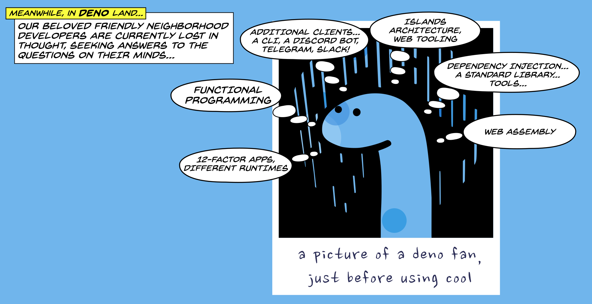

# eserstack

> **Note:** JSR is frozen at 4.5.x. From 5.0.0 the `@eserstack/*` libraries are
> published on npm under the same names, and the `eser`, `noskills` and `laroux`
> tools as the npm packages of those names; the JSR versions stay available but
> get no updates.

[](https://www.npmjs.com/package/eser)
[](https://codecov.io/gh/eser/stack)
[](https://github.com/eser/stack/actions/workflows/build.yml)

<p align="center">
  <a href="./">
    
  </a>
</p>

eserstack is eser's personal software workshop — a foundation layer, developer
tools, and product incubator, all built on a single philosophy.

> This workshop runs on a shared philosophy ([PHILOSOPHY.md](./PHILOSOPHY.md))
> and a common set of directives that apply across all packages, contributors,
> and community channels
> ([@eserstack/directives](./pkg/@eserstack/directives/README.md)).

## Why eserstack?

Built for developers who:

- **Think in layers** — foundation first, tools on top, products last
- **Believe in explicit constraints** — quality is encoded at the start, not
  gated at the end
- **Want human-in-the-loop AI** — tools that think but don't decide
- **Build to ship** — real products, not perpetual side projects

## Packages

### Foundation

Stable, minimal, rarely changes. Axioms the rest builds on.

| Package                                             | Description                                              |
| --------------------------------------------------- | -------------------------------------------------------- |
| [@eserstack/primitives](pkg/@eserstack/primitives/) | Result\<T,E\>, Option\<T\>, type guards                  |
| [@eserstack/fp](pkg/@eserstack/fp/)                 | 70+ functional programming combinators                   |
| [@eserstack/di](pkg/@eserstack/di/)                 | IoC container, Registry, Scope                           |
| [@eserstack/standards](pkg/@eserstack/standards/)   | Cross-runtime, i18n, formatters, logging levels          |
| [@eserstack/functions](pkg/@eserstack/functions/)   | Monadic do-notation, middleware, trigger adapters        |
| [@eserstack/events](pkg/@eserstack/events/)         | Event bus, pub/sub                                       |
| [@eserstack/directives](pkg/@eserstack/directives/) | Ecosystem ground rules — technical and social directives |

### Libraries & Tools

Active, maintained, published independently. No CLI (Libraries) or
workflow-facing (Tools).

| Package                                           | Description                                                    |
| ------------------------------------------------- | -------------------------------------------------------------- |
| [@eserstack/shell](pkg/@eserstack/shell/)         | CLI framework: args, completions, exec, TUI                    |
| [@eserstack/formats](pkg/@eserstack/formats/)     | Bidirectional format conversion (JSON, YAML, CSV, TOML, JSONL) |
| [@eserstack/streams](pkg/@eserstack/streams/)     | Pipeline I/O                                                   |
| [@eserstack/logging](pkg/@eserstack/logging/)     | Hierarchical logging, OpenTelemetry                            |
| [@eserstack/codebase](pkg/@eserstack/codebase/)   | Git ops, scaffolding, version management                       |
| [@eserstack/workflows](pkg/@eserstack/workflows/) | Event-driven workflow engine                                   |
| [@eserstack/ai](pkg/@eserstack/ai/)               | AI provider abstraction (Claude, OpenAI, Gemini)               |

<details>
<summary>Full list (all Libraries & Tools)</summary>

**Libraries**

| Package                                             | Description                                                    |
| --------------------------------------------------- | -------------------------------------------------------------- |
| [@eserstack/formats](pkg/@eserstack/formats/)       | Bidirectional format conversion (JSON, YAML, CSV, TOML, JSONL) |
| [@eserstack/streams](pkg/@eserstack/streams/)       | Pipeline I/O                                                   |
| [@eserstack/parsing](pkg/@eserstack/parsing/)       | Tokenizer, lexer, AST                                          |
| [@eserstack/logging](pkg/@eserstack/logging/)       | Hierarchical logging, OpenTelemetry                            |
| [@eserstack/http](pkg/@eserstack/http/)             | HTTP middleware, response helpers                              |
| [@eserstack/httpclient](pkg/@eserstack/httpclient/) | HTTP client with timeouts, retries and typed errors            |
| [@eserstack/crypto](pkg/@eserstack/crypto/)         | Web Crypto wrappers                                            |
| [@eserstack/cache](pkg/@eserstack/cache/)           | XDG cache directories                                          |
| [@eserstack/config](pkg/@eserstack/config/)         | .env + env var configuration                                   |
| [@eserstack/testing](pkg/@eserstack/testing/)       | fakeFs, fakeServer, tempDir                                    |
| [@eserstack/collector](pkg/@eserstack/collector/)   | Export manifest generation                                     |
| [@eserstack/cs](pkg/@eserstack/cs/)                 | Kubernetes ConfigMap/Secret sync from .env files               |
| [@eserstack/agents](pkg/@eserstack/agents/)         | Coding agent discovery and the read-only git guard             |
| [@eserstack/ajan](pkg/@eserstack/ajan/)             | Go/WASM FFI bridge                                             |
| [@eserstack/kit](pkg/@eserstack/kit/)               | Recipe registry, distribution protocol, handlers               |

**Tools**

| Package                                               | Description                                           |
| ----------------------------------------------------- | ----------------------------------------------------- |
| [@eserstack/bundler](pkg/@eserstack/bundler/)         | Abstract bundler, snapshot AOT                        |
| [@eserstack/shell](pkg/@eserstack/shell/)             | CLI framework: args, completions, exec, TUI           |
| [@eserstack/mux](pkg/@eserstack/mux/)                 | Terminal multiplexer engine: tabs, panes, keybindings |
| [@eserstack/codebase](pkg/@eserstack/codebase/)       | Git ops, scaffolding, version management              |
| [@eserstack/workflows](pkg/@eserstack/workflows/)     | Event-driven workflow engine                          |
| [@eserstack/kit](pkg/@eserstack/kit/)                 | Recipe + template distribution                        |
| [@eserstack/cli](pkg/@eserstack/cli/)                 | Main entrypoint CLI                                   |
| [@eserstack/ai](pkg/@eserstack/ai/)                   | AI provider abstraction (Claude, OpenAI, Gemini)      |
| [@eserstack/app-runtime](pkg/@eserstack/app-runtime/) | Application lifecycle management                      |

</details>

### Products

Growing toward — or already with — their own identity.

| Package                                                     | Status            | Description                                              |
| ----------------------------------------------------------- | ----------------- | -------------------------------------------------------- |
| [@eserstack/noskills](pkg/@eserstack/noskills/)             | **GRADUATED**     | AI development orchestrator                              |
| [@eserstack/noskills-web](pkg/@eserstack/noskills-web/)     | Product           | web dashboard for noskills                               |
| [@eserstack/laroux](pkg/@eserstack/laroux/)                 | Product-Candidate | framework-agnostic web core — Growing toward graduation. |
| [@eserstack/laroux-react](pkg/@eserstack/laroux-react/)     | Product-Candidate | React integration for laroux                             |
| [@eserstack/laroux-server](pkg/@eserstack/laroux-server/)   | Product-Candidate | SSR runtime for laroux                                   |
| [@eserstack/laroux-bundler](pkg/@eserstack/laroux-bundler/) | Product-Candidate | build pipeline for laroux                                |

### Where to start

| Goal                                | Entry point                                                                          |
| ----------------------------------- | ------------------------------------------------------------------------------------ |
| AI-assisted project development     | **noskills** → [install](#noskills)                                                  |
| Add typed utilities to your project | **@eserstack/fp**, **@eserstack/di** → `pnpm add @eserstack/fp`                      |
| Build a web app                     | **laroux** → [laroux docs](./pkg/@eserstack/laroux/README.md)                        |
| Understand the philosophy           | **PHILOSOPHY.md** → [read it](./PHILOSOPHY.md)                                       |
| Understand how eserstack operates   | **@eserstack/directives** → [ecosystem rules](./pkg/@eserstack/directives/README.md) |

## noskills

[](https://www.npmjs.com/package/noskills)

> AI development orchestrator — structured discovery, human-in-the-loop, quality
> gates. Before a single line of code, noskills asks the right questions.

**Standalone install:**
`curl -fsSL https://raw.githubusercontent.com/eser/stack/main/etc/scripts/install.sh | sh -s noskills`
(or brew/npm/nix — see [Install the CLI](#install-the-cli)) **In Claude Code:**
Add to your project and use via `npx noskills spec new "description"`

<!-- TODO: record demo GIF showing CC agent workflow -->

[How it works →](./pkg/@eserstack/noskills/README-HOW.md)

## 🚀 Jumpstart

The install script, Homebrew and Nix install Go binaries that need no other
runtime. The npm packages need [Node.js](https://nodejs.org/) 26.9 or later.

### Install the CLI

```bash
# macOS / Linux — install script
curl -fsSL https://raw.githubusercontent.com/eser/stack/main/etc/scripts/install.sh | sh
# Downloads the eser binary to ~/.local/bin. Inspect the script before running:
# https://raw.githubusercontent.com/eser/stack/main/etc/scripts/install.sh
# A specific release instead of the latest one:
curl -fsSL https://raw.githubusercontent.com/eser/stack/main/etc/scripts/install.sh | ESER_INSTALL_VERSION=4.5.2 sh

# Windows (PowerShell); set $env:VERSION = "4.5.2" first for a specific release
irm https://raw.githubusercontent.com/eser/stack/main/etc/scripts/install.ps1 | iex

# Homebrew
brew install eser/tap/eser

# Nix
nix run github:eser/stack

# npm / npx
npm install -g eser
# or: npx eser <command>
```

### The rest of the family

Four tools ship from this repo, all at one version from one pipeline:

| Binary            | What it is                    | Install                           |
| ----------------- | ----------------------------- | --------------------------------- |
| `eser`            | the full CLI                  | `curl -fsSL .../install.sh \| sh` |
| `noskills`        | the spec workflow, on its own | `... \| sh -s noskills`           |
| `laroux`          | the laroux.js CLI, on its own | `npm i -g laroux` (from 5.0.0)    |
| `noskills-server` | the session daemon (Go)       | `... \| sh -s noskills-server`    |

The installer is
`https://raw.githubusercontent.com/eser/stack/main/etc/scripts/install.sh`, and
the product is its argument. On Windows use `install.ps1` with `-Product`.
Homebrew has a formula per binary (`brew install eser/tap/noskills`), and
`eser`, `noskills` and `laroux` are also on npm.

The installer reads the release it installs from, the latest one or the one
`ESER_INSTALL_VERSION` (`$env:VERSION` or `-Version` on Windows) names. When that release has no
archive of the product for your platform, the installer prints the
`npm i -g <product>` command for it and exits without installing. From 5.0.0
laroux is on npm only, so `sh -s laroux` prints `npm i -g laroux`; an installed
v4.5.x laroux binary updates to a stub that runs the npm package.

`noskills` and `laroux` are not separate programs — they are the same modules
`eser` mounts, re-rooted so they can be installed alone. Every one of them
carries the same `system` tree:

```bash
noskills system install     # also: uninstall, update, completions,
noskills system doctor      #       version, doctor, info
noskills version            # short aliases: install, update, version, doctor
```

Submodules deliberately do not: `eser noskills version` does not exist, because
a submodule is not a program with a version of its own. `noskills-server` is the
exception in the other direction — being a Go daemon, it has its own command set
(`start`, `doctor`, `pin`, `install-service`, `quickstart`) rather than this
one.

### Browse available recipes

```bash
$ eser kit list

PROJECTS
  library-pkg          Workspace library package with tests and README
  laroux-app           Laroux.js web application with SSR and React
  go-service           Go microservice with hexagonal architecture
  ...

UTILITIES
  fp-pipe              Functional pipe and compose utilities
  ajan-httpfx          Ajan HTTP server framework
  ...
```

### Create a new project

```bash
$ eser kit new laroux-app --name my-site

✓ Created my-site with 13 file(s)
```

### Add a recipe to an existing project

```bash
$ eser kit add fp-pipe

✓ Added 1 file(s) from fp-pipe
  → lib/fp/pipe.ts
  ✓ npm install @eserstack/fp
```

## Contributors

<!-- CONTRIBUTORS:START -->
<table>
  <tr>
    <td align="center"><a href="https://github.com/eser"><br /><sub>eser</sub></a></td>
    <td align="center"><a href="https://github.com/ayhansipahi"><br /><sub>ayhansipahi</sub></a></td>
    <td align="center"><a href="https://github.com/wralith"><br /><sub>wralith</sub></a></td>
  </tr>
</table>
<!-- CONTRIBUTORS:END -->

## 🙋🏻 FAQ

### Want to report a bug or request a feature?

If you're going to report a bug or request a new feature, please ensure first
that you comply with the conditions found under
[@eserstack/directives](./pkg/@eserstack/directives/README.md). After that, you
can report an issue or request using
[GitHub Issues](https://github.com/eser/stack/issues). Thanks in advance.

### Want to contribute?

It is publicly open for any contribution from the community. Bug fixes, new
features and additional components are welcome.

If you're interested in becoming a contributor and enhancing the ecosystem,
please start by reading through our [CONTRIBUTING.md](.github/CONTRIBUTING.md).

If you're not sure where to begin, take a look at the
[issues](https://github.com/eser/stack/issues) labeled `good first issue` and
`help wanted`. Reviewing closed issues can also give you a sense of the types of
contributions we're looking for and you can tackle.

If you're already an experienced OSS contributor, let's take you to the shortest
path: To contribute to the codebase, just fork the repo, push your changes to
your fork, and then submit a pull request.

### Requirements

- Node.js 26.9 or higher (https://nodejs.org/); `.node-version` pins the
  version CI uses
- pnpm 11.18.0 (https://pnpm.io/)
- Go 1.26 or higher (https://go.dev/) for the Go packages and binaries

### Versioning

This project follows [Semantic Versioning](https://semver.org/). For the
versions available, see the
[tags on this repository](https://github.com/eser/stack/tags).

### License

This project is licensed under the Apache 2.0 License. For further details,
please see the [LICENSE](LICENSE) file.

### To support the project...

[Visit my GitHub Sponsors profile at github.com/sponsors/eser](https://github.com/sponsors/eser)
